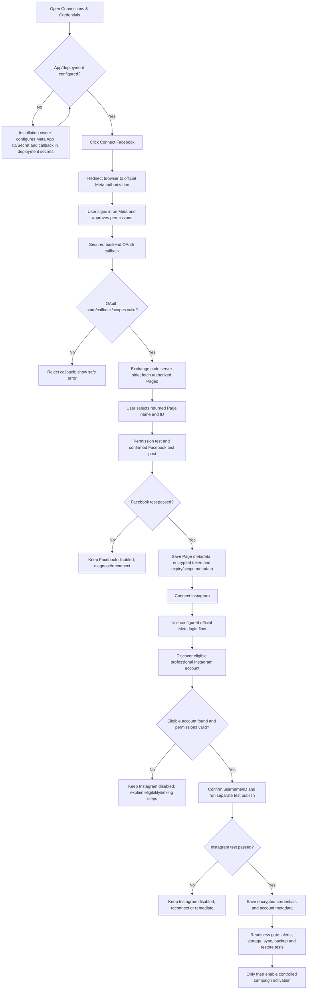

# AdvertFloz BYOK and OAuth connection flow — v1.7

## Ownership boundary

- The operator provides account consent on Meta and selects the returned Page/account.
- The installer supplies Meta App/Cloudflare/GitHub/Telegram secrets through deployment secret settings. They are not ordinary form fields.
- OAuth access tokens are received by the backend and never shown in the UI.
- Page names/IDs are provider metadata. They are not credentials.
- Each platform has an independent readiness and pause state.
