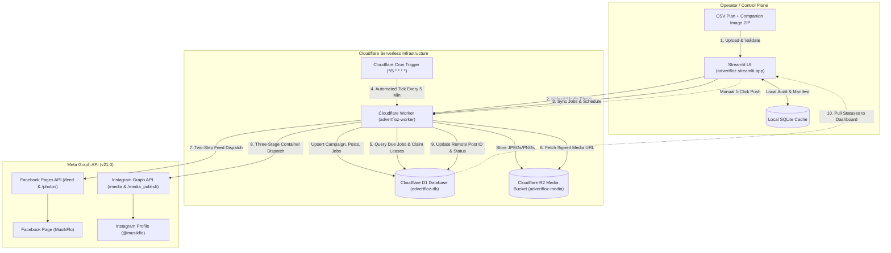
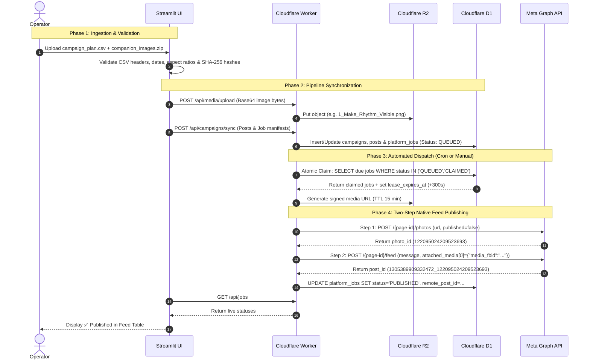

# AdvertFloz: Complete System Architecture & Integration Guide

A production-grade, distributed social media campaign scheduling and execution engine built with **Streamlit (Control Plane)**, **Cloudflare Workers (Execution Plane)**, **Cloudflare D1 (Database)**, **Cloudflare R2 (Media Storage)**, and the **Meta Graph API (Facebook & Instagram)**.

---

## 1. High-Level System Architecture

AdvertFloz operates on a **Split-Plane Architecture**:
* **Control Plane (Streamlit)**: Local or hosted operator UI for campaign creation, CSV/ZIP content validation, phone previews, and pipeline monitoring.
* **Remote Plane (Cloudflare Serverless)**: Autonomous 24/7/365 cron dispatcher running in Cloudflare's global edge network, immune to local computer shutdowns.



---

## 2. Infrastructure Components & Connections

### 2.1 Cloudflare Worker (`advertfloz-worker`)
* **Role**: The stateless execution brain. It handles REST API requests from Streamlit, processes OAuth callbacks from Meta, validates HMAC authentication headers, and executes cron-driven publishing cycles.
* **Compatibility Date**: `2026-01-01`
* **Public Domain**: `https://advertfloz-worker.pravindev666.workers.dev`
* **Cron Schedule**: `*/5 * * * *` (Fires every 5 minutes, 24/7/365).

### 2.2 Cloudflare D1 Database (`advertfloz-db`)
* **Database ID**: `fbe9e8ac-a22d-4994-9150-63b44d5efd43`
* **Binding**: `DB`
* **Tables**:
  * `campaigns` & `campaign_revisions`: Immutable revision history and campaign tags.
  * `posts`: Text, captions, image IDs, and platform routing targets.
  * `platform_jobs`: Atomic job queue (`QUEUED`, `CLAIMED`, `PUBLISHED`, `FAILED`, `PAUSED`) with idempotency keys and lease expiration timestamps.
  * `connections` & `connection_tokens`: AES-GCM encrypted Meta Page Access Tokens and long-lived system credentials.
  * `runtime_flags`: Emergency circuit breakers (`pause_all`, `pause_facebook`, heartbeat timestamps).

### 2.3 Cloudflare R2 Media Bucket (`advertfloz-media`)
* **Binding**: `MEDIA`
* **Role**: S3-compatible zero-egress object storage for graphics, banners, and square post images.
* **Serving**: Media files are served to Meta's crawlers via time-limited, signed URLs (`R2_SIGNED_URL_TTL_SECONDS = 900`).

### 2.4 Control Plane (Streamlit App)
* **Framework**: Python 3.11+ / Streamlit
* **Live Deployment**: `https://advertfloz.streamlit.app`
* **Local Mode**: `http://localhost:8501`
* **Core Pages**:
  1. `Home (Overview)`: 5-question executive dashboard (Active Campaigns, Next Scheduled Run, Published Posts, Attention/Issues, Connected Services).
  2. `Quick Campaign`: 5-step guided wizard (Platform selection, Drag & Drop CSV/ZIP, Multi-post phone preview, Target confirmation, Preflight & Push).
  3. `Publishing Pipelines`: Execution command center, live progress bar, platform filters, and 1-click batch publishing.
  4. `Facebook & Instagram Operations`: Dedicated linkage, token health, and format diagnostics.

---

## 3. End-to-End Post Lifecycle



---

## 4. The Critical Facebook Feed Fix (Photos vs. Scrollable Feed)

### 4.1 The Problem
When posting via the standard `POST /{page-id}/photos` endpoint with `published=true`, Facebook's Graph API treats the upload as a **Photo Library Upload**. This resulted in:
* Photos being dumped into the **Photos album** on the left sidebar.
* Posts not rendering as primary story cards on the main timeline.
* Rapid multiple uploads being bundled into a single silent photo album.

### 4.2 The Solution: Two-Step Feed Attachment
AdvertFloz now uses the exact same two-step protocol that Facebook's native UI uses when a user clicks *"What's on your mind?"* → attaches a photo → clicks Post:

1. **Step 1 (Upload Invisible Photo Asset)**:
   ```http
   POST https://graph.facebook.com/v21.0/{page-id}/photos
   url=<signed-r2-url>&published=false&access_token=<page-token>
   ```
   *Response*: Returns `{ "id": "122095024209523693" }` *(Photo FBID, unpublished and invisible)*.

2. **Step 2 (Publish Native Feed Story)**:
   ```http
   POST https://graph.facebook.com/v21.0/{page-id}/feed
   message=<caption-text>&attached_media[0]={"media_fbid":"122095024209523693"}&access_token=<page-token>
   ```
   *Response*: Returns `{ "id": "1305389909332472_122095024209523693" }` *(Permanent timeline feed story ID)*.

**Result**: Every post appears as an individual, high-visibility, scrollable post with full caption, engagement buttons (Like, Comment, Share), and link previews.

---

## 5. Platform Separation: Facebook vs. Instagram

| Feature | Facebook Pipeline | Instagram Pipeline |
| :--- | :--- | :--- |
| **Target Node** | Facebook Page (`MusikFlo`) | Instagram Professional Profile (`@musikflo`) |
| **API Endpoint** | `/{page-id}/feed` with attached photo | `/{ig-user-id}/media` + `/{ig-user-id}/media_publish` |
| **Publishing Protocol**| 2-Step Direct Atomic Call | 3-Stage Durable State Machine (`CREATE_CONTAINER` → `CHECK_STATUS` → `PUBLISH`) |
| **Discovery** | Auto-detected from `me/accounts` | Auto-discovered from Page's `instagram_business_account` |
| **Aspect Ratios** | Any aspect ratio supported | 4:5 to 1.91:1 (1:1 Square recommended) |
| **Step 1 Filter** | Can be selected independently | Can be selected independently |

---

## 6. Configuration & Secrets Reference

### 6.1 Streamlit Secrets (`.streamlit/secrets.toml`)
```toml
# Local Secrets (Git-ignored)
ADVERTFLOZ_MODE = "local"
ADVERTFLOZ_DEFAULT_TIMEZONE = "Asia/Kolkata"

# Master Operator Password
ADVERTFLOZ_ADMIN_PASSWORD = "<redacted>"

# Cloudflare Worker Connection
WORKER_BASE_URL = "https://advertfloz-worker.pravindev666.workers.dev"
WORKER_SERVICE_KEY = "<shared-hmac-key>"

# Meta Developer App
META_APP_ID = "1630923065352103"
META_APP_SECRET = "<app-secret>"
META_GRAPH_VERSION = "v21.0"
```

### 6.2 Cloudflare Worker Config (`worker/wrangler.toml`)
```toml
name = "advertfloz-worker"
main = "src/index.ts"
compatibility_date = "2026-01-01"

[triggers]
crons = ["*/5 * * * *"]

[[d1_databases]]
binding = "DB"
database_name = "advertfloz-db"
database_id = "fbe9e8ac-a22d-4994-9150-63b44d5efd43"
migrations_dir = "migrations"

[[r2_buckets]]
binding = "MEDIA"
bucket_name = "advertfloz-media"

[vars]
META_APP_ID = "1630923065352103"
META_GRAPH_VERSION = "v21.0"
CONTROL_PLANE_URL = "https://advertfloz.streamlit.app"
META_OAUTH_REDIRECT_URI = "https://advertfloz-worker.pravindev666.workers.dev/oauth/meta/callback"
R2_SIGNED_URL_TTL_SECONDS = "900"
```

---

## 7. Meta App Compliance & Live Mode Endpoints

To support transitioning the Meta App to **Live Mode**, the Cloudflare Worker exposes three fully compliant, public HTML endpoints:

* **Privacy Policy**: `https://advertfloz-worker.pravindev666.workers.dev/privacy`
* **Terms of Service**: `https://advertfloz-worker.pravindev666.workers.dev/terms`
* **User Data Deletion**: `https://advertfloz-worker.pravindev666.workers.dev/data-deletion`

---

## 8. Operational Playbook

### Running a 365-Day Scheduled Campaign
1. Open **Quick Campaign** (`/quick_campaign`).
2. **Step 1**: Select **Facebook** only (or both), choose or create a campaign name (e.g. `musikflo-365`).
3. **Step 2**: Drag and drop your 365-row CSV and companion images ZIP.
4. **Step 3**: Review multi-post phone previews and click **Approve All Images**.
5. **Step 4**: Verify your target page (`MusikFlo`) and default timezone (`Asia/Kolkata`).
6. **Step 5**: Click **🚀 Push & Schedule to Cloudflare**.
7. *Turn off your laptop.* The Cloudflare cron trigger will wake up every 5 minutes and post each item on its designated calendar day and time.

### Publishing Everything Immediately (Test & Blast Mode)
1. Open **Pipelines** (`/pipelines`).
2. Select your pipeline from the dropdown.
3. Click **`🚀 Publish Entire Pipeline Now`**.
4. The system will force all pending scheduled dates to `NOW`, loop the execution engine, and publish all posts directly to your feed within seconds!
